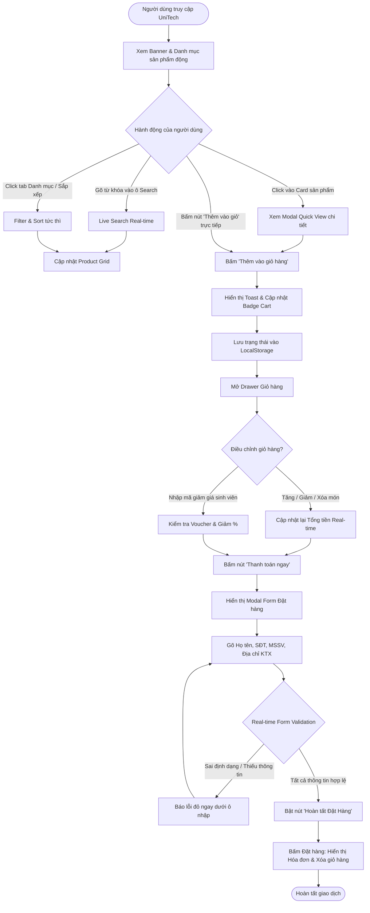

# KẾ HOẠCH DỰ ÁN CUỐI KHÓA (PBL - PHASE 1: PLANNING & PROTOTYPING)
## HỌC PHẦN 111101: THIẾT KẾ WEB · ĐẠI HỌC LẠC HỒNG (LHU)
### TUẦN 13 · SPRINT 1: PLANNING & CORE UI

---

## THÔNG TIN TỔNG QUAN DỰ ÁN
* **Tên dự án:** **UniTech - Campus Store** (Hệ thống Web thương mại điện tử chuyên cung cấp thiết bị và phụ kiện công nghệ thông minh dành cho sinh viên)
* **Khoa / Trường:** Khoa Công Nghệ Thông Tin – Trường Đại học Lạc Hồng
* **Học phần:** 111101 - Thiết Kế Web
* **Mô hình triển khai:** Agile / Scrum đơn giản kết hợp Vibe Coding (AI-Assisted Development)
* **Repository GitHub:** `huuphuocgith2802/tuan13baitap_website-` (https://github.com/huuphuocgith2802/tuan13baitap_website-)

---

## 1. MỤC TIÊU BÀI HỌC & CHUẨN ĐẦU RA (LESSON OBJECTIVES & LLOS)
* **Về kiến thức:**
  * Hiểu và vận dụng quy trình phát triển phần mềm theo mô hình Agile/Scrum: Product Backlog, Sprint Backlog, Sprint Planning, User Stories và Scrum Roles.
* **Về kỹ năng:**
  * Lập kế hoạch dự án bằng tài liệu `PLAN.md`, phân chia công việc theo các GitHub Issues rõ ràng.
  * Xây dựng sơ đồ Luồng người dùng (User Flow) và Luồng dữ liệu (Data Flow).
  * Vận dụng kỹ năng tổ chức mã nguồn dạng Module (Clean Code: `data.js`, `ui.js`, `app.js`).
* **Về thái độ:**
  * Rèn luyện tinh thần làm việc nhóm, trách nhiệm cá nhân, tư duy giải quyết vấn đề thực tế của sinh viên.
* **Chuẩn đầu ra đạt được:**
  * **LLO 4.1.1:** Xác định bài toán thực tế (thiết bị học tập & code cho sinh viên) và giải pháp web tương ứng.
  * **LLO 4.1.2:** Sử dụng AI để sinh danh sách 5 User Stories cốt lõi và kiến tạo cấu trúc thư mục dự án chuẩn.
  * **LLO 4.1.3:** Phân chia nhiệm vụ trên GitHub Projects và hệ thống GitHub Issues.
  * **LLO 4.1.4:** Thiết kế sơ đồ luồng dữ liệu (Data Flow) và luồng người dùng (User Flow) hoàn chỉnh.

---

## 2. HOẠT ĐỘNG 1: "PROJECT PITCHING" - BẢO VỆ Ý TƯỞNG
### 2.1. Đặt vấn đề thực tế (Problem Statement)
Sinh viên ngành Công nghệ thông tin và sinh viên đại học nói chung tại LHU thường xuyên gặp khó khăn khi tìm kiếm phụ kiện học tập, lập trình:
* Bàn phím cơ quá ồn làm ảnh hưởng người khác khi học tại thư viện.
* Giá đỡ laptop không chuẩn khiến ngồi lâu bị đau mỏi vai gáy và cột sống.
* Thiếu cổng kết nối (HDMI, Type-C) khi cần thuyết trình đồ án trên giảng đường.
* Kinh phí eo hẹp, khó tiếp cận nguồn hàng uy tín có trợ giá và chế độ bảo hành thân thiện với sinh viên.

### 2.2. Giải pháp đề xuất (Proposed Solution)
Xây dựng website **UniTech - Campus Store**:
* Giao diện hiện đại, tối ưu cho cả điện thoại (Mobile First) và máy tính (Desktop).
* Danh mục sản phẩm chọn lọc dành riêng cho sinh viên: Chuột silent, bàn phím cơ không dây, tai nghe chống ồn ôn thi, củ sạc GaN 65W, hub thuyết trình, đèn bảo vệ mắt, balo chống gù.
* Chính sách trợ giá sinh viên (-10% đến -25%), hỗ trợ nhập mã giảm giá sinh viên (`SINHVIEN10`, `FREESHIP`).

### 2.3. Các tính năng sử dụng JavaScript cốt lõi
1. **Dynamic Rendering:** Toàn bộ danh mục và thẻ sản phẩm được render động từ mảng Object trong `data.js`, tuyệt đối không dùng HTML tĩnh.
2. **Real-time Live Search:** Người dùng gõ từ khóa vào ô tìm kiếm, sản phẩm lọc và cập nhật ngay lập tức (`input` event).
3. **Category Filtering & Dynamic Sorting:** Lọc theo danh mục tức thì, sắp xếp theo giá tăng/giảm và đánh giá rating cao nhất.
4. **Interactive Shopping Cart:** Thêm sản phẩm vào giỏ, cập nhật số lượng (+/-), tính tổng tiền, giảm giá voucher, lưu trữ liên tục bằng `localStorage`.
5. **Real-time Form Validation:** Kiểm tra hợp lệ form đặt hàng ngay khi gõ (Tên, SĐT chuẩn VN, MSSV, Địa chỉ ký túc xá/phòng trọ) với phản hồi màu sắc và thông báo lỗi tức thì.
6. **Toast Notification System:** Hiển thị thông báo trạng thái đẹp mắt, sinh động khi thêm giỏ hàng, áp mã giảm giá, đặt hàng.

---

## 3. CƠ CẤU ĐỘI NGŨ & MÔ HÌNH AGILE / SCRUM
Dự án được triển khai theo mô hình Scrum tinh gọn:

| Thành viên / Vai trò | Vị trí đảm nhận | Trách nhiệm chính |
| :--- | :--- | :--- |
| **Đinh Hữu Phước** | **Product Owner (PO)** & **Scrum Master (SM)** | - Xác định yêu cầu bài toán, lập Product Backlog.<br>- Điều phối tiến độ Sprint 1, gỡ bỏ rào cản kỹ thuật.<br>- Quản lý GitHub Repository và cấu trúc dự án. |
| **Dev 1 (Frontend UI)** | **Frontend Engineer** | - Xây dựng cấu trúc HTML5 Semantic và Layout CSS (Flexbox/Grid).<br>- Tối ưu giao diện Responsive, Modal, Cart Drawer, Animation. |
| **Dev 2 (Core Logic & Data)**| **JavaScript Logic Engineer** | - Xây dựng cấu trúc dữ liệu `data.js`.<br>- Triển khai các module `ui.js` và `app.js` (Search realtime, giỏ hàng, validation). |

---

## 4. PRODUCT BACKLOG & 5 USER STORIES TRỌNG TÂM (SPRINT 1)

Dựa trên yêu cầu tạo ra sản phẩm khả dụng tối thiểu (MVP), nhóm xác định 5 User Stories cốt lõi cho Sprint 1:

### 🔹 User Story 1: Hiển thị sản phẩm động từ mảng dữ liệu (Dynamic Product Catalog)
* **Là một:** Sinh viên ghé thăm website.
* **Tôi muốn:** Xem danh sách tất cả các sản phẩm công nghệ hiển thị kèm ảnh, tên, giá bán, giá gốc, nhãn giảm giá và đánh giá sao.
* **Để:** Tôi có thể nắm bắt nhanh các sản phẩm đang có bán và thông số nổi bật.
* **Tiêu chí nghiệm thu (Acceptance Criteria - AC):**
  * *Given:* Dữ liệu sản phẩm được định nghĩa trong mảng Object `data.js`.
  * *When:* Trang web được tải.
  * *Then:* JavaScript tự động duyệt mảng và render đầy đủ các card sản phẩm vào `#product-grid` mà không có bất kỳ thẻ sản phẩm tĩnh nào trong HTML.

### 🔹 User Story 2: Tìm kiếm sản phẩm Real-time (Real-time Live Search)
* **Là một:** Người dùng cần tìm nhanh món đồ cụ thể (ví dụ: "chuột", "sạc", "bàn phím").
* **Tôi muốn:** Kết quả tìm kiếm xuất hiện ngay tức thì khi tôi gõ từng ký tự vào ô search mà không cần bấm Enter hay tải lại trang.
* **Để:** Tiết kiệm thời gian tra cứu và trải nghiệm mua sắm mượt mà.
* **Tiêu chí nghiệm thu (AC):**
  * *Given:* Người dùng đứng tại trang chủ với thanh tìm kiếm.
  * *When:* Người dùng gõ từ khóa vào `<input id="search-input">`.
  * *Then:* Sự kiện `input` kích hoạt hàm lọc, cập nhật danh sách hiển thị trong < 100ms, nếu không tìm thấy hiển thị thông báo "Không tìm thấy sản phẩm phù hợp".

### 🔹 User Story 3: Lọc theo danh mục & Sắp xếp giá (Filter & Sort)
* **Là một:** Sinh viên có ngân sách cố định hoặc cần tìm theo chủng loại thiết bị.
* **Tôi muốn:** Nhấp vào các tab danh mục ("Chuột & Bàn phím", "Âm thanh", "Cáp sạc GaN", "Setup bàn học") và chọn sắp xếp giá từ thấp đến cao hoặc cao xuống thấp.
* **Để:** Nhanh chóng chọn được sản phẩm phù hợp túi tiền sinh viên.
* **Tiêu chí nghiệm thu (AC):**
  * *Given:* Danh mục các nút filter hiển thị trực quan.
  * *When:* Người dùng click vào tab danh mục hoặc chọn dropdown sắp xếp.
  * *Then:* Danh sách cập nhật tức thời theo đúng điều kiện kết hợp cả danh mục + từ khóa search + thứ tự sắp xếp.

### 🔹 User Story 4: Quản lý giỏ hàng trực quan (Interactive Cart & LocalStorage)
* **Là một:** Người mua hàng.
* **Tôi muốn:** Nhấn nút "Thêm vào giỏ" trên thẻ sản phẩm, xem số lượng trên huy hiệu giỏ hàng tăng lên, mở drawer giỏ hàng để tăng/giảm số lượng hoặc xóa sản phẩm.
* **Để:** Quản lý danh sách các món đồ dự định mua và theo dõi tổng chi phí tức thời.
* **Tiêu chí nghiệm thu (AC):**
  * *Given:* Sản phẩm có sẵn trong kho.
  * *When:* Nhấn "Thêm vào giỏ", hệ thống hiển thị Toast notification, cập nhật badge giỏ hàng và lưu vào `localStorage`.
  * *Then:* Khi mở giỏ hàng, thông tin số lượng, đơn giá và tổng thành tiền được tính toán chính xác 100%.

### 🔹 User Story 5: Xác thực đơn hàng Real-time (Real-time Checkout Validation)
* **Là một:** Sinh viên chuẩn bị hoàn tất đơn đặt hàng.
* **Tôi muốn:** Nhập thông tin liên hệ (Họ tên, SĐT, MSSV, Địa chỉ ký túc xá/phòng trọ) và nhận phản hồi lỗi/hợp lệ ngay khi đang gõ từng ô.
* **Để:** Tôi biết ngay mình nhập sai ở đâu (ví dụ: SĐT thiếu số, MSSV sai định dạng) trước khi ấn gửi đơn hàng.
* **Tiêu chí nghiệm thu (AC):**
  * *Given:* Form đặt hàng trong modal thanh toán.
  * *When:* Người dùng gõ dữ liệu vào các trường input.
  * *Then:* Viền input đổi màu xanh (hợp lệ) hoặc đỏ (kèm thông điệp lỗi cụ thể) ngay lập tức; nút "Xác nhận đặt hàng" chỉ kích hoạt khi tất cả dữ liệu hợp lệ.

---

## 5. SƠ ĐỒ LUỒNG NGƯỜI DÙNG (USER FLOW DIAGRAM)



---

## 6. SƠ ĐỒ LUỒNG DỮ LIỆU (DATA FLOW DIAGRAM)

```mermaid
flowchart LR
    subgraph Data Layer [Module: data.js]
        DB[(Mảng PRODUCTS)]
        CATS[(Mảng CATEGORIES)]
        VOUCHERS[(Mảng VOUCHERS)]
    end

    subgraph Controller Logic [Module: app.js]
        State[App State: filter, search, sort, cart]
        SearchHandler[Hàm searchProductsRealtime]
        FilterHandler[Hàm filterAndSortProducts]
        CartHandler[Hàm handleCartActions]
        ValidationHandler[Hàm validateFormRealtime]
    end

    subgraph UI Render [Module: ui.js]
        RenderGrid[renderProducts]
        RenderCart[renderCartDrawer]
        RenderModal[openProductModal]
        RenderToast[showToastNotification]
        RenderBadge[updateCartBadge]
    end

    subgraph Storage & DOM
        LS[(Browser LocalStorage)]
        DOM[HTML5 Semantic DOM Tree]
    end

    DB --> State
    CATS --> State
    VOUCHERS --> CartHandler

    DOM -.->|Sự kiện input, click, change| ControllerLogic
    ControllerLogic --> UI Render
    UI Render --> DOM
    CartHandler <--> LS
```

---

## 7. THIẾT KẾ CẤU TRÚC DỮ LIỆU OBJECT (DATA SPECIFICATIONS)

Cấu trúc mỗi sản phẩm trong `data.js` được chuẩn hóa như sau:

```javascript
{
  id: 1,
  name: "Chuột không dây Logitech Pebble M350 Silent",
  category: "mouse-keyboard",
  categoryName: "Chuột & Bàn phím",
  price: 320000,              // Giá bán khuyến mãi (VNĐ)
  originalPrice: 450000,      // Giá niêm yết (VNĐ)
  discount: 29,               // % giảm giá
  rating: 4.8,                // Đánh giá sao (1 - 5)
  reviewsCount: 142,          // Số lượt đánh giá
  image: "assets/images/mouse-pebble.jpg",
  inStock: true,              // Trạng thái còn hàng
  stockQuantity: 35,          // Số lượng trong kho
  badges: ["Bán chạy", "Silent Click"], // Nhãn nổi bật
  shortDesc: "Công nghệ click êm ái 90%, kết nối kép Bluetooth & USB receiver.",
  specs: {
    "Kết nối": "Bluetooth Low Energy & USB 2.4GHz",
    "Độ phân giải": "1000 DPI mượt mà",
    "Thời lượng pin": "18 tháng (1 pin AA)",
    "Trọng lượng": "100g siêu nhẹ",
    "Bảo hành": "12 tháng 1 đổi 1"
  }
}
```

---

## 8. BẢN VẼ PHÁC THẢO GIAO DIỆN (WIREFRAME PROTOTYPE)

### 8.1. Wireframe Giao diện Desktop (1200px+)
```text
+-----------------------------------------------------------------------------------+
|  [Logo UniTech]   [🔍 Tìm kiếm sản phẩm realtime...]    [Trợ giá SV]  [🛒 Giỏ (3)]|
+-----------------------------------------------------------------------------------+
|                                                                                   |
|  HERO BANNER: "THIẾT BỊ HỌC TẬP & LẬP TRÌNH CHO SINH VIÊN LẠC HỒNG (LHU)"         |
|  - Giảm giá đến 35% cho sinh viên có thẻ MSSV                                     |
|  [ Khám phá ngay ]    [ Nhận voucher SINHVIEN10 ]                                 |
|                                                                                   |
+-----------------------------------------------------------------------------------+
|  [Danh mục: Tất cả | Chuột & Bàn phím | Âm thanh | Sạc GaN | Setup bàn học]       |
|  Sắp xếp: [Giá tăng dần v]                 Đang hiển thị: 12/12 sản phẩm          |
+-----------------------------------------------------------------------------------+
|  +--------------------+  +--------------------+  +--------------------+  +-----+  |
|  | [Badge Giảm 29%]   |  | [Badge Bán chạy]   |  | [Badge Sinh viên]  |  |     |  |
|  | [ẢNH SẢN PHẨM]     |  | [ẢNH SẢN PHẨM]     |  | [ẢNH SẢN PHẨM]     |  | ... |  |
|  | Tên sản phẩm       |  | Tên sản phẩm       |  | Tên sản phẩm       |  |     |  |
|  | ★★★★☆ (4.8)        |  | ★★★★★ (5.0)        |  | ★★★★☆ (4.7)        |  |     |  |
|  | 320.000đ  450.000đ |  | 690.000đ  890.000đ |  | 450.000đ  580.000đ |  |     |  |
|  | [Xem nhanh] [🛒]   |  | [Xem nhanh] [🛒]   |  | [Xem nhanh] [🛒]   |  |     |  |
|  +--------------------+  +--------------------+  +--------------------+  +-----+  |
+-----------------------------------------------------------------------------------+
|  FOOTER: Học phần 111101 · Thiết Kế Web - Đại học Lạc Hồng · Đinh Hữu Phước       |
+-----------------------------------------------------------------------------------+
```

### 8.2. Wireframe Giỏ hàng Drawer & Modal Checkout
```text
+--------------------------------------+   +--------------------------------------+
|  GIỎ HÀNG CỦA BẠN (3 món)        [X] |   |  THÔNG TIN ĐẶT HÀNG SINH VIÊN    [X] |
+--------------------------------------+   +--------------------------------------+
| [x] Chuột Logitech Pebble            |   | Họ và tên: [Nguyễn Văn A           ] |
|     320.000đ  [-] 1 [+]  [Xóa]       |   | Số điện thoại: [0912345678       ✓ ] |
| [x] Giá đỡ Laptop nhôm 360           |   | Mã số sinh viên (MSSV): [123456  ✓ ] |
|     249.000đ  [-] 2 [+]  [Xóa]       |   | Địa chỉ nhận (KTX / Trọ): [Phòng 204]|
+--------------------------------------+   | Phương thức: (•) COD  ( ) QR Chuyển  |
| Nhập Voucher: [SINHVIEN10] [Áp dụng] |   +--------------------------------------+
| Tạm tính:             818.000đ       |   | Tổng thanh toán: 736.200đ (-10% SV)  |
| Giảm giá SV:          -81.800đ       |   | [    XÁC NHẬN ĐẶT HÀNG (ENABLED)   ] |
| TỔNG CỘNG:            736.200đ       |   +--------------------------------------+
| [     TIẾN HÀNH ĐẶT HÀNG      ]      |
+--------------------------------------+
```

---

## 9. BẢNG PHÂN CHIA NHIỆM VỤ GITHUB PROJECTS & ISSUES (SPRINT 1)

Nhóm phân chia 10 Issues chi tiết trên GitHub theo chuẩn Agile/Scrum:

| Issue # | Tên nhiệm vụ (Task Title) | Module liên quan | Người phụ trách | Độ ưu tiên | Trạng thái |
| :---: | :--- | :--- | :--- | :---: | :---: |
| **#01** | Khởi tạo cấu trúc thư mục dự án và tài liệu `PLAN.md` | Docs / Root | Đinh Hữu Phước (PO) | P0 (Cao nhất) | Hoàn thành |
| **#02** | Xây dựng bộ khung HTML5 Semantic & Responsive Layout | `index.html`, `css/` | Dev Frontend | P0 | Hoàn thành |
| **#03** | Thiết kế bộ dữ liệu Object chi tiết 12+ sản phẩm trong `data.js` | `js/data.js` | Dev Logic | P0 | Hoàn thành |
| **#04** | Xây dựng module hiển thị `ui.js`: Render danh sách sản phẩm động | `js/ui.js` | Dev Logic / UI | P0 | Hoàn thành |
| **#05** | Phát triển tính năng Real-time Search khi người dùng gõ phím | `js/app.js` | Dev Logic | P0 | Hoàn thành |
| **#06** | Phát triển tính năng lọc danh mục và sắp xếp giá/đánh giá | `js/app.js`, `js/ui.js` | Dev Logic | P1 | Hoàn thành |
| **#07** | Xây dựng Modal Quick View xem chi tiết thông số sản phẩm | `js/ui.js`, `css/` | Dev Frontend | P1 | Hoàn thành |
| **#08** | Xây dựng Drawer Giỏ hàng, tính tổng tiền và lưu `localStorage` | `js/app.js`, `js/ui.js` | Dev Logic | P0 | Hoàn thành |
| **#09** | Xây dựng Form đặt hàng với Real-time Validation (Regex VN, MSSV) | `js/app.js`, `css/` | Dev Logic | P0 | Hoàn thành |
| **#10** | Tích hợp hệ thống thông báo Toast Notification và tối ưu UX | `js/ui.js`, `css/` | Dev Frontend | P1 | Hoàn thành |

---

## 10. ĐÁNH GIÁ ĐẠT 3 THỬ THÁCH KỸ THUẬT (PROJECT CHALLENGES)

1. **Thử thách 1: Dynamic (100% Render từ mảng Object):**
   * Trong file `index.html`, thẻ `#product-grid` hoàn toàn rỗng. Toàn bộ danh sách card sản phẩm, thông số, nhãn giá, tag giảm giá được hàm `renderProducts()` trong `ui.js` tạo ra và gắn vào DOM một cách tự động từ mảng `PRODUCTS` trong `data.js`.
2. **Thử thách 2: Real-time UX (Trải nghiệm thời gian thực):**
   * Khi người dùng gõ vào ô search, sự kiện `input` lọc danh sách sản phẩm tức thì trong tích tắc mà không cần bấm Enter hay load lại trang.
   * Form đặt hàng kiểm tra (Validate) trực tiếp trên từng phím gõ (real-time feedback): icon xanh khi đúng, thông báo lỗi đỏ ngay khi sai định dạng.
   * Badge số lượng giỏ hàng nhảy số với hiệu ứng nảy (bounce animation) ngay khi bấm thêm giỏ hàng.
3. **Thử thách 3: Clean Code (3 Modules tách biệt hoàn toàn):**
   * `js/data.js`: Chứa dữ liệu thuần túy (Mảng sản phẩm, danh mục, voucher).
   * `js/ui.js`: Chuyên trách render và thao tác DOM (Tạo card, render giỏ hàng, mở/đóng modal, hiển thị toast notification).
   * `js/app.js`: Module điều phối logic chính (Xử lý sự kiện, thuật toán tìm kiếm, giỏ hàng, kiểm tra tính hợp lệ form, lưu trữ `localStorage`).

---

## 11. DANH MỤC CHECKLIST MILESTONE 1 (PBL MILESTONE 1 CHECKLIST)
- [x] Có file `PLAN.md` mô tả chi tiết bài toán, giải pháp, phân vai Scrum và 5 User Stories.
- [x] Cấu trúc dữ liệu Object đã hoàn thiện, phong phú, logic chặt chẽ trong `data.js`.
- [x] Phân chia công việc rõ ràng trên GitHub với bảng 10 Issues có người phụ trách cụ thể.
- [x] Có bản vẽ phác thảo Wireframe (cả dạng sơ đồ cấu trúc và giao diện chạy trực tiếp).
- [x] Đã khởi tạo Git Repository và đẩy toàn bộ mã nguồn lên GitHub.
